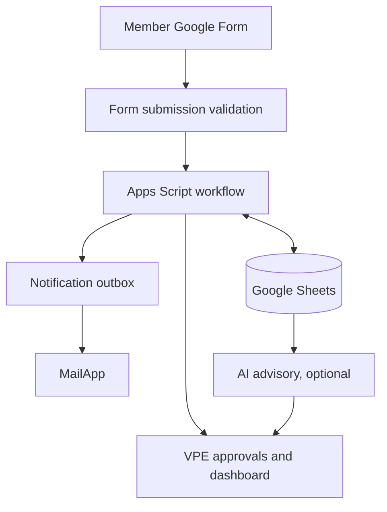

# System architecture (MVP)

Core Sheets: Members, Roles, Meetings, Availability, Assignments, Responses, Participation, Notifications, Audit_Log, Settings. Raw Form Responses stored separately.
Sheets is the operational source of truth, but not a transactional DB: use lock + optimistic version + event IDs + reconciliation.
Identity: verified Google Forms account email matched to member directory; require authorized membership. Prefilled URLs do not authenticate a person.
AI reads minimal pseudonymized summaries and suggests; deterministic code validates. VPE decides.
Notification outbox supports QUEUED, SENDING, SENT, FAILED, AMBIGUOUS. Do not blindly replay AMBIGUOUS.
Timezone: Asia/Kolkata in UI, UTC ISO 8601 in logs; scheduling rules use club-local wall clock.
