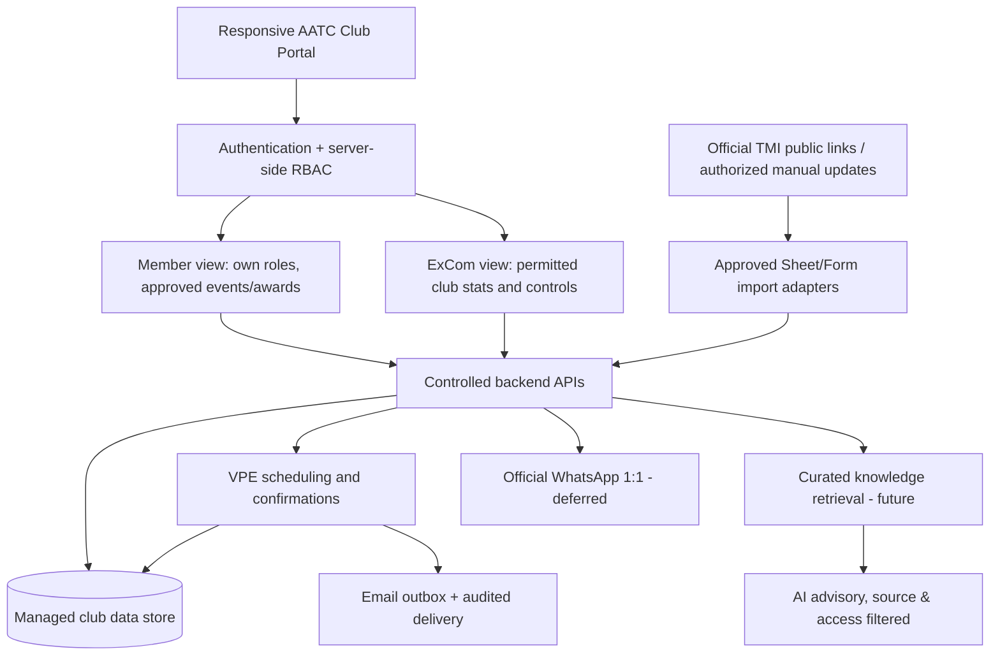

# Architecture — single portal, modular VPE first

## Architecture rules
1. Modular monolith initially; avoid microservice/agent sprawl. Shared identity and data schema support future ExCom modules.
2. Firebase Auth + Firestore + Cloud Functions/Run are evaluation candidates, NOT implementation commitments. Compare a Google-first alternative (Forms/Sheets/Apps Script) under 40 members and forecast cost/maintenance/security; document decision.
3. Server-side RBAC: anonymous guests see only approved public club information; members see own private records and approved club-wide data; ExCom sees only role-granted scopes. Default deny, time-limited officer privileges and revocation after office term.
4. AATC portal is club-owned and branded as club use, with required TMI legal/disclaimer content and official website links. No officer-only side websites.
5. Attendance, membership and educational-progress figures are club-maintained and may lag official TMI systems; label source, freshness and verification. No assumed TMI API/portal automation.
6. Raw WhatsApp history, private secretary documents and member-only TMI content are excluded from general-purpose AI ingestion. Only nonconfidential club-authored FAQ items specifically cleared for AI processing; internal reports and communications are never submitted to external AI tools absent authoritative policy clarification.
7. All mutable workflows emit audit events. All messages use queue/idempotency, safe opt-out and escalation; AI has no write permission.
8. Runtime configuration and API keys are server-side. Instrument quotas and cost caps. Backups + manual fallback are mandatory.
9. Detect job failures, perform bounded tested retries and reconcile ambiguous sends. Feature/code repair creates draft PR for human review; never auto-deploy.
10. Privacy: explicit consent, narrow purpose, data minimization, configurable retention, access requests/deletion workflow and approved photos/award visibility.
